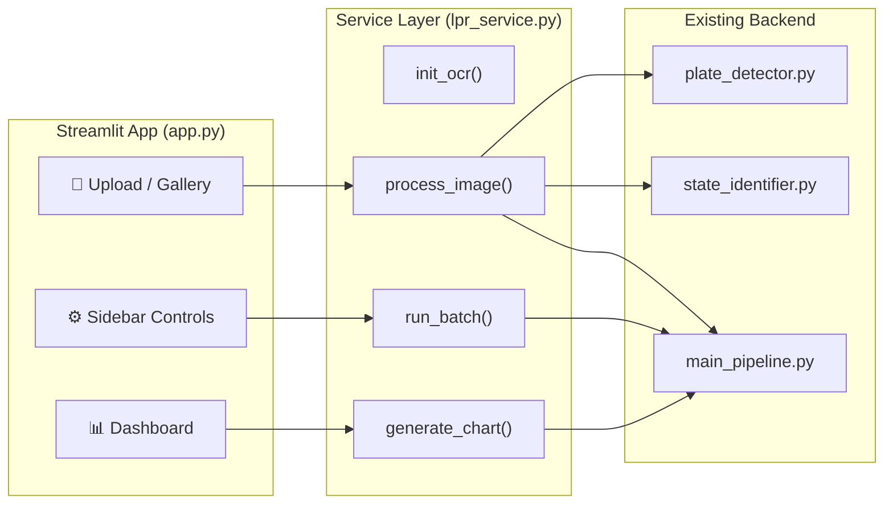

# Streamlit Frontend — Implementation Plan

> [!NOTE]
> **Status (updated after review):** implemented. Two changes from the original plan:
> (1) the duplicated pipeline code was removed. `lpr_service.py` is now the single
> implementation, and `main_pipeline.py` became a thin command-line wrapper that loads
> EasyOCR lazily (no import-time side effects), so the "do not modify / do not import"
> constraints below no longer apply; (2) ground-truth evaluation (`evaluate.py`) was added.
> See README.md for the current structure.

## 1. Architecture Overview

The GUI wraps the existing backend (3 modules) without modifying them. A thin **service layer** decouples Streamlit from the pipeline internals.



> [!IMPORTANT]
> **Do NOT modify** `plate_detector.py`, `state_identifier.py`, or `main_pipeline.py`. All Streamlit logic lives in two new files only: `app.py` and `lpr_service.py`.

---

## 2. Current Codebase Analysis

### Reusable Functions (no changes needed)

| Function | Module | Purpose | Streamlit Usage |
|---|---|---|---|
| `detect_plates(image)` | plate_detector | Returns candidate dicts with `bbox`, `score` | Single-image mode |
| `extract_plate_region(image, cand)` | plate_detector | Returns `(color, resized, binary, inv)` tuple | Plate crop display |
| `preprocess_image(image)` | plate_detector | Returns `(gray, denoised)` | Preprocessing viz |
| `identify_state(text)` | state_identifier | Returns `(state, prefix, type)` | Result cards |
| `process_single_image(path)` | main_pipeline | Full pipeline for one image | **Core of single-image mode** |
| `run_pipeline(sample_size)` | main_pipeline | Batch processing with metrics | **Core of batch mode** |
| `plot_all_graphs(metrics)` | main_pipeline | Saves 8 PNG charts to disk | Dashboard graphs |
| `recognize_text(plate_img)` | main_pipeline | EasyOCR wrapper | Live OCR display |

### Problem: Module-level Side Effects

`main_pipeline.py` has code that runs at **import time**:

```python
# Lines 30-37 — runs on import!
print("=" * 70)
print("LICENSE PLATE RECOGNITION & STATE IDENTIFICATION SYSTEM")
import easyocr
reader = easyocr.Reader(['en'], gpu=False, verbose=False)
```

> [!WARNING]
> **This is a blocker.** Streamlit re-runs the script on every interaction. The EasyOCR reader must be initialized only once via `@st.cache_resource`. The service layer will handle this by managing its own reader instance.

---

## 3. File Structure (After Implementation)

```
IPPR Assignment/
├── app.py                    ← NEW: Streamlit entry point
├── lpr_service.py            ← NEW: Service layer (wraps backend)
├── main_pipeline.py          ← UNCHANGED
├── plate_detector.py         ← UNCHANGED
├── state_identifier.py       ← UNCHANGED
├── train/                    ← Dataset (1816 images)
├── evaluation_graphs/        ← Generated charts
└── output/sample_detections/ ← Annotated images
```

---

## 4. Detailed Implementation Plan

### Phase 1: Service Layer (`lpr_service.py`)

**Purpose:** Isolate backend dependencies so Streamlit never imports `main_pipeline.py` directly (avoiding side-effect prints and duplicate EasyOCR init).

```python
# Key responsibilities:
class LPRService:
    def __init__(self):
        self.reader = None   # Lazy-loaded EasyOCR
    
    def init_reader(self):
        """Called once via @st.cache_resource"""
        import easyocr
        self.reader = easyocr.Reader(['en'], gpu=False, verbose=False)
    
    def process_image(self, image_bgr) -> dict:
        """Process a single BGR image array → detection results"""
        # Reuse detect_plates + extract_plate_region + recognize_text
    
    def process_uploaded_file(self, uploaded_file) -> dict:
        """Convert Streamlit UploadedFile → BGR array → process"""
    
    def run_batch(self, image_dir, sample_size, progress_cb) -> (list, dict):
        """Batch process with Streamlit progress callback"""
    
    def annotate_image(self, image, detections) -> np.ndarray:
        """Draw bboxes + labels on image for display"""
    
    def get_chart_figure(self, chart_type, metrics) -> plt.Figure:
        """Return matplotlib Figure (not save to disk) for st.pyplot()"""
```

> [!TIP]
> **Key design decision:** Return `matplotlib.Figure` objects instead of saving to disk. This lets Streamlit render them inline with `st.pyplot(fig)` without file I/O.

#### Functions to implement:

| Function | Logic Source | Adaptation |
|---|---|---|
| `process_image()` | Mirrors `process_single_image()` L56-210 | Accepts ndarray instead of path; uses service's own `reader` |
| `run_batch()` | Mirrors `run_pipeline()` L218-299 | Adds `progress_cb(current, total)` for `st.progress()` |
| `annotate_image()` | Mirrors `save_sample_detections()` L513-536 | Returns image instead of saving |
| `get_chart_figure()` | Mirrors `plot_all_graphs()` L306-508 | Returns `fig` instead of `plt.savefig()` |

---

### Phase 2: Streamlit App (`app.py`)

#### 2a. Page Layout

```
┌─────────────────────────────────────────────────────┐
│  🔍 Malaysian License Plate Recognition System      │ ← Header
├────────────┬────────────────────────────────────────┤
│  SIDEBAR   │                                        │
│            │   [Tab 1: Single Image]                │
│  Mode:     │   [Tab 2: Batch Analysis]              │
│  ○ Single  │   [Tab 3: Dataset Gallery]             │
│  ○ Batch   │                                        │
│            │                                        │
│  Settings: │                                        │
│  Max dim   │                                        │
│  Conf thrs │                                        │
│            │                                        │
│  About     │                                        │
│  ✗ No Haar │                                        │
│  ✗ No TF   │                                        │
└────────────┴────────────────────────────────────────┘
```

#### 2b. Tab 1 — Single Image Analysis

**User flow:** Upload image → Process → Show results

| Component | Streamlit Widget | Data Source |
|---|---|---|
| Image upload | `st.file_uploader(type=['jpg','png'])` | User upload |
| OR gallery pick | `st.selectbox()` with train/ filenames | `train/` directory |
| Process button | `st.button("🔍 Detect Plates")` | — |
| Original image | `st.image()` | Uploaded file |
| Annotated image | `st.image()` | `annotate_image()` result |
| Detection cards | `st.columns()` per detection | `process_image()['detections']` |
| Plate crop | `st.image()` inside card | `det['plate_img']` |
| OCR text | `st.metric()` inside card | `det['plate_text']` |
| State badge | `st.success/warning/info()` | `det['state']` |
| Confidence | `st.progress()` bar | `det['score']` |
| Timing | `st.caption()` | `result['total_time']` |
| Preprocessing viz | `st.expander("🔬 Pipeline Steps")` | Show gray, edges, binary |

#### 2c. Tab 2 — Batch Analysis Dashboard

**User flow:** Select sample size → Run → View metrics & charts

| Component | Widget | Data |
|---|---|---|
| Sample size slider | `st.slider(50, 1816, 200)` | Controls `run_batch(sample_size=)` |
| Run button | `st.button("🚀 Run Batch Analysis")` | Triggers processing |
| Progress bar | `st.progress()` + `st.status()` | Updated via `progress_cb` |
| KPI row | 4× `st.metric()` in columns | Detection rate, valid rate, avg time, states |
| Charts | `st.pyplot()` in 2×2 grid | 8 chart types via `get_chart_figure()` |
| State table | `st.dataframe()` | `metrics['states_distribution']` |
| Export button | `st.download_button()` | CSV of all results |

#### 2d. Tab 3 — Dataset Gallery

**User flow:** Browse dataset images with pagination

| Component | Widget | Data |
|---|---|---|
| Page selector | `st.number_input()` | Pagination (20 per page) |
| Image grid | `st.columns(4)` with `st.image()` | `train/` thumbnails |
| Click to analyze | `st.button()` per image | Routes to Tab 1 |

---

### Phase 3: Streamlit-Specific Concerns

#### 3a. Caching Strategy

```python
@st.cache_resource
def get_lpr_service():
    """Initialize once, persist across reruns."""
    service = LPRService()
    service.init_reader()  # ~3-5 sec EasyOCR load
    return service

@st.cache_data(ttl=3600)
def process_cached(image_hash):
    """Cache results for identical images."""
    ...
```

> [!NOTE]
> `@st.cache_resource` for the EasyOCR reader (mutable, shared object).
> `@st.cache_data` for processing results (immutable, per-image).

#### 3b. Session State Management

```python
# Track across reruns:
st.session_state.batch_results    # Batch analysis results
st.session_state.batch_metrics    # Metrics dict
st.session_state.selected_image   # Gallery → Single Image routing
st.session_state.processing       # Lock to prevent double-clicks
```

#### 3c. Performance Guardrails

| Concern | Solution |
|---|---|
| EasyOCR loads on every rerun | `@st.cache_resource` — load once |
| Large image display lag | Resize to 800px max before `st.image()` |
| Batch processing blocks UI | `st.status()` container with live updates |
| Memory with 1816 images | Process in chunks of 50, clear intermediates |
| Matplotlib backend conflict | Force `matplotlib.use('Agg')` before import |

---

## 5. Implementation Order & Effort

| Step | Task | Est. Lines | Depends On |
|:---:|---|:---:|:---:|
| 1 | Create `lpr_service.py` — core service class | ~200 | — |
| 2 | Create `app.py` — page layout, sidebar, header | ~50 | Step 1 |
| 3 | Implement Tab 1: Single Image mode | ~120 | Step 1 |
| 4 | Implement Tab 2: Batch Dashboard | ~150 | Step 1 |
| 5 | Implement Tab 3: Dataset Gallery | ~60 | Step 2 |
| 6 | Add preprocessing visualization expander | ~40 | Step 3 |
| 7 | Polish CSS styling & dark theme | ~30 | Steps 3-5 |
| 8 | Test full flow end-to-end | — | All |

**Total estimated: ~650 lines across 2 files.**

---

## 6. Dependencies

```bash
pip install streamlit
# Already installed: opencv-python, easyocr, matplotlib, numpy, Pillow
```

**Launch command:**
```bash
cd "/Users/macbookair/Downloads/IPPR Assignment "
streamlit run app.py
```

---

## 7. Risk Assessment

| Risk | Impact | Mitigation |
|---|---|---|
| `main_pipeline.py` import triggers prints + EasyOCR init | App crash / double init | Service layer bypasses main_pipeline imports; directly imports `plate_detector` and `state_identifier` |
| Streamlit reruns on every click | Slow UX | Aggressive caching + session state |
| EasyOCR full-image scan = ~3s/image | Batch mode very slow | Show progress bar; cap default sample at 100 |
| `matplotlib.use('Agg')` conflicts | Plot errors | Set backend before any plt import in service layer |
| Large train/ directory listing | Slow gallery | Lazy-load with pagination (20/page) |

> [!CAUTION]
> The biggest architectural risk is importing `main_pipeline.py` — it executes EasyOCR initialization at module level. The service layer **must not import main_pipeline**. Instead, it should duplicate the ~50 lines of `process_single_image()` logic while importing only `plate_detector` and `state_identifier` (which have no side effects).
